  
  
  

Desenvolvo aplicações web e transformo layouts do Figma em interfaces responsivas. Estudo Ciência da Computação e venho me aprofundando em **cibersegurança (CyberSec)**. Também exploro eletrônica, sistemas embarcados e segurança de hardware.

  

  <h2>Stack</h2>
  
<strong>Front-end e design</strong>

  

  
<strong>Bancos de dados e ORM</strong>

  

  
<strong>Versionamento e ambiente</strong>

  

